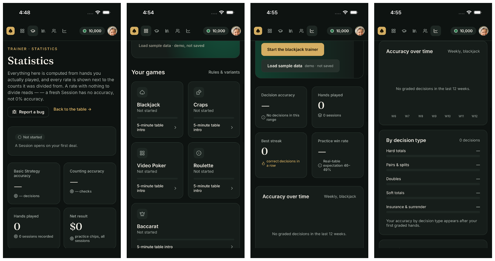

# MVP completion record

Status: implementation and automated verification pass on web, the iOS simulator,
and the final EAS-signed Android APK offline. Physical-device acceptance remains open.

Scope comes from the user's MVP request, `CONTEXT.md`, accepted ADRs, the 18 frames
in `design/Truecount-claude.pen`, and platform issue
[#13](https://github.com/0xRowdy/true-count-claude/issues/13). Existing branding is
Tableside; the repository and bundle identifiers retain True Count.

ADR-0003 establishes a local-first MVP. Accounts, payment processing, community
publication and network multiplayer need a separate product decision. Their design
screens must identify previews, examples and simulations clearly. This does not
exclude working local strategy editing, all five games, training, history or backup.

## Design coverage

| Frame                              | Implemented surface                 | Behavioral proof                        |
| ---------------------------------- | ----------------------------------- | --------------------------------------- |
| `bi8Au` Design System              | `/design-system`                    | `design-system`                         |
| `Do2ZB` Landing                    | `/`                                 | `landing`, `links`                      |
| `aLrYu` Onboarding                 | `/onboarding`                       | `onboarding`                            |
| `ZDK1x` Lobby                      | `/lobby`                            | `lobby`                                 |
| `CcmBm` Blackjack betting          | `/play`                             | `play-round`                            |
| `N6Lcl` Blackjack mistake          | `/play`                             | `blackjack-coach`                       |
| `WSAfm` Blackjack result           | `/play`                             | `play-round`, `no-hole-card`            |
| `w7wLdL` Blackjack payout          | `/play`                             | `play-round`, `early-surrender`         |
| `dBsVJ` Roulette                   | `/games/roulette`                   | `game-roulette`                         |
| `lUiCl` Craps                      | `/games/craps`                      | `game-craps`                            |
| `xfJEh` Video Poker                | `/games/video-poker`                | `game-video-poker`                      |
| `gu3Mf` Baccarat                   | `/games/baccarat`                   | `game-baccarat`                         |
| `LvXnf` Progress                   | `/progress`                         | `progress`                              |
| `RYP9O` Blackjack strategy builder | `/strategies/blackjack`             | `strategies`, `strategy-handoff`        |
| `QEqUW` Multiplayer presentation   | `/live/craps`, explicitly simulated | `live-craps`                            |
| `VcZwn` Pricing                    | `/pricing`, explicitly a preview    | `pricing`                               |
| `GYRRl` Craps strategy builder     | `/strategies/craps`                 | `strategy-craps`, `strategy-handoff`    |
| `D0h320` Roulette strategy builder | `/strategies/roulette`              | `strategy-roulette`, `strategy-handoff` |

Flow names refer to `.agents/skills/verify-true-count/flows/<name>.mjs`.
Rendered screenshots and `result.json` files are under `.verify/evidence/`.
A route or passing unit test alone does not establish visual or behavioral completion.

## Product invariants

| Requirement                          | Implementation and authoritative checks                                                                                                                                                                                |
| ------------------------------------ | ---------------------------------------------------------------------------------------------------------------------------------------------------------------------------------------------------------------------- |
| No second training paywall           | All drills, history and builders work locally. Landing and pricing flows must show free scope and preview disclosures.                                                                                                 |
| Explanation for every wrong verdict  | Drill/explanation tests and `drills`, `true-count-drill`, `blackjack-coach`; verify the reason and chart/EV where applicable.                                                                                          |
| Feedback while cards remain visible  | `blackjack-coach`, `drills`; screenshots show both the hand and feedback.                                                                                                                                              |
| Auditable strategy                   | Rule chart UI; independently captured chart fixtures with provenance in `src/engine/fixtures/README.md`; cell-by-cell comparisons across every generated family. Split context has separate legal-action and EV tests. |
| Verifiable shoe                      | Seeded composition/conservation and full-shoe balanced-count tests; `rules-integrity`; export/replay tests. Cut-card RC is not required to be zero.                                                                    |
| Recover from zero bankroll           | `recovery-report` depletes all five bankrolls, resets each through its visible button, preserves history and starts another round. Nonblackjack balances also survive reload.                                          |
| Buttons and every legal action       | Engine legality tests and actual table controls; insurance, early surrender, no-peek and split/double regressions.                                                                                                     |
| Offline-first, no login              | Production cache installation, offline grading/reload/routes, and safe update/failure behavior in `offline` and `offline-updates`. Native bundles must run without Metro.                                              |
| Zero ads                             | No advertising SDK or ad UI in source/dependencies.                                                                                                                                                                    |
| In-app bug reporting with hand state | `recovery-report` opens the report during a real hand, verifies exact cards, seed and actions with reconstruction/replay flags, and compares the downloaded report byte for byte.                                      |

EV values are estimates based on remaining composition. The UI describes the
solver's replacement-draw and split-continuation approximations. Reference-chart
correctness is checked independently of this solver.

## Persistence and resilience

Session backup includes blackjack Play and Drill sessions. It does not promise to
back up settings, strategy drafts or other-game progress. `session-backup` covers
export, merge restore, reload, duplicate preservation, malformed input, nested
corruption and storage-read recovery. Repository tests cover partial storage failure
and retries. Persisted replay uses saved snapshots/outcomes for compatibility.

Custom roulette progressions have separate win/loss rules, persist with drafts,
appear in Compare, and drive seeded session simulation. Engine tests cover push
behavior, minimum stakes and table caps. `strategy-roulette` exercises editing,
reload and simulation through the UI.

## Competitor review

[CQ Nexus functionality](research/cqnexus-functionality.md) separates exercised
flows, visible controls, first-party advertised capabilities and roadmap items.
Evidence is in `.verify/competitor/`. The October review supersedes September
product-availability and pricing claims, while retaining the older review sample as
historical research. The report includes completed Roulette, Craps, Video Poker,
Baccarat and Pachinko rounds, Blackjack training controls, trackers and goals. Paid,
social and untested workflows are identified explicitly.

## Platform gates

| Gate                                             | Current evidence                                                                                                                                                                                      |
| ------------------------------------------------ | ----------------------------------------------------------------------------------------------------------------------------------------------------------------------------------------------------- |
| Typecheck, lint, formatting, all unit tests      | Final source passes typecheck, lint and formatting. The prior full unit run passed 3,079 tests in 89 files; this follow-up changes layout only. `git diff --check` is clean.                          |
| Fresh web export and complete browser suite      | All 29 flows pass with no console errors. The final week-label adjustment then passes Progress, trainer layout, and hydration checks on a fresh export.                                               |
| iOS and Android JS exports                       | Earlier exports passed; these do not prove native build/runtime behavior.                                                                                                                             |
| EAS account and project                          | Authenticated as `mmgjlegacy`, linked project `15b42160-932f-4c21-bfd0-b6a539d7cf94`.                                                                                                                 |
| Installable Android APK                          | Layout-corrected build `74a79d38-741a-44aa-bf01-7caf62ce2762` passes all six native flows offline in 247 seconds. Valid APK v2/v3 signature with the existing signer.                                 |
| iOS simulator binary and automated runtime check | Layout-corrected build `01864a54-3ffd-485b-9fa9-85f9944d5d78` passes all six native flows in 436 seconds. Successful runtime workflow: `01a1636e-6353-75e2-8ea2-0531cb3ae1ab`. Screenshots inspected. |
| Physical iOS                                     | User confirmed Expo Go launch, backup creation, drill persistence after reopening, and the corrected Statistics layout.                                                                               |
| Android emulator                                 | Latest signed APK passes with Wi-Fi and mobile data disabled: drill/backup/restart, blackjack settlement, onboarding, other games, eight trainer headers, and Lobby/Progress card layouts.            |
| Physical Android                                 | User has no Android device. Emulator evidence does not satisfy physical acceptance in #13.                                                                                                            |

During the 2026-10-22 physical iPhone check, the LAN QR timed out; the user reached
the app using the Tailscale address and confirmed that Create backup displayed
“Backup ready”. After reopening Expo Go, the user explicitly confirmed that History
still showed the completed drill. This passes the focused launch, drill, backup,
and restart-persistence smoke test on a physical iPhone. The phone's chart values
have not been compared with its saved records. Statistics is reached through
Drills → Your record → Statistics; the backup controls are at the bottom of that
screen. Physical Android acceptance remains open.

The native workflows are `.eas/workflows/native-smoke.yml` and
`.eas/workflows/native-repack.yml`. Assertions live in all six `.maestro/native-*.yml`
files. The game flow covers Roulette and Baccarat results, a seeded Video Poker
deal/hint/draw/collection, and a Craps come-out roll establishing the point. The
broader browser suite covers additional behavior. Release instructions live in
[releasing.md](releasing.md).

Native runtime testing found platform-specific defects that browser tests cannot
catch. Rendering text before bundled fonts loaded clipped labels and paragraphs;
native startup now waits for readiness, with an error fallback. Baccarat and Video
Poker treated React Native's `window` as a browser and called missing event methods;
those listeners now require the web platform. Video Poker receives its replay seed
from Expo Router on both native and web, instead of reading a browser URL.
Native safe areas protect content from system bars. Nine SVG background components
now use unpadded absolute wrappers, fixing truncated gradients inside padded native
parents. Before/after screenshots confirm the corrected landing, Baccarat and Video
Poker backgrounds.
Standalone iOS testing also exposed an Expo Handoff configuration alert caused by
rendering browser page metadata through native `Head`. The root now renders `Head`
only on web. This was invisible in Expo Go, which does not enable the native module.

The final EAS artifacts listed above supersede the October 21 builds, base builds and the local
debug-signed x86_64 APK. The local APK remains useful as intermediate evidence; use
the final EAS APK for Android distribution. Physical iPhone distribution outside
Expo Go requires a separately signed build; the verified iOS artifact targets the simulator.
The original source manifest records the 395 file hashes used for the local APK
and first repacks. `release-source-manifest.json` preserves a separate 395-file
snapshot for the final Head correction and iOS confirmation handling; all of those
hashes matched the worktree before the corrected repacks were submitted.

## Layout follow-up, 2026-10-22

A physical iPhone screenshot exposed text compressed into a narrow column on
Statistics. Android Expo Go reproduced it at the default text size: the title
occupied 178 of 1,080 screen pixels. The mobile browser did not reproduce it.
Trainer headers now stack their actions below the title on narrow screens. The
corrected native title occupies 996 pixels, and the user confirmed the iPhone fix.

Visual inspection also found five Lobby game cards and four Progress statistic
cards squeezed into single rows. Minimum card widths now enforce wrapping. Stat
notes wrap inside their cards. Weekly chart labels retain readable widths in a
horizontal scroller that initially shows the latest week.

The iOS simulator captures show Statistics, Lobby cards, Progress cards and chart labels:

The previous smoke checks scrolled past broken headers. New native checks require
header actions in the initial viewport and require cards on separate rows. Both
checks failed on the old Android artifact and pass on the corrected builds. Native
screenshots cover all eight shared headers, the Lobby cards, Progress cards and
week labels. The drill smoke script now centers the keypad digit before tapping
and verifies the entered value; centering Clear could leave the digit under the
fixed navigation header after the layout changed.

- Full browser sweep: `.verify/layout-browser-results.json`, 29 passes, no console
  errors; `/tmp/truecount-layout-final-browser.log`.
- Final chart checks: `/tmp/truecount-layout-chart-web.log`; Progress, trainer
  layout at four widths, and hydration all pass with no console errors.
- Android: `.verify/native/android-layout-complete.xml`, six passes offline;
  screenshots in `.verify/native/android-layout-complete/`.
- iOS: `.verify/native/ios-layout-complete-evidence/`, six passes on iPhone 17 Pro,
  iOS 26.5. `.verify/native/ios-layout-complete-contact.png` collects the corrected
  Statistics, Lobby, Progress, and chart captures.
- Source snapshot: `.verify/native/layout-complete-source-manifest.json`, all 397
  file hashes checked against the worktree. Artifact URLs, expiry, SHA-256 hashes,
  and Android signing certificate: `.verify/native/layout-artifacts.json`.
- Local binaries: `.verify/native/truecount-android-layout.apk` and
  `.verify/native/truecount-ios-layout.tar.gz`. They supersede the binaries below.

## Earlier evidence, 2026-10-21

- Unit run: `/tmp/truecount-tests-release.log`, 89 files and 3,079 tests.
- Lint and formatting: `/tmp/truecount-lint-release.log` and
  `/tmp/truecount-format-release.log`.
- Browser sweep: `/tmp/truecount-browser-complete.log` and
  `.verify/final-browser-results.json`, all 28 flows pass with empty console-error
  arrays. Evidence directories run from `20261021-130820-blackjack-coach` through
  `20261021-131121-true-count-drill` under `.verify/evidence/`.
- Recovery and actual hand report: `.verify/evidence/20261021-131053-recovery-report/`.
- After the Head correction: `/tmp/truecount-web-head-check.log` records passing
  hydration, drill and link flows; `.verify/web-head-titles.json` records browser
  titles on load and client navigation. `.verify/web-head-export-equivalence.json`
  confirms all 63 production web files are unchanged from the full browser sweep.
- Local Android release: `.verify/native/truecount-native-complete.apk`,
  SHA256 `a533b53fd4deb1501487ac09360bcba81c5fc509090f6a254e312391009fc7ae`.
  Bundle/source-map and signing evidence are in the matching `-provenance.json`
  and `-signature.txt` files.
- Local offline Android suite: `.verify/native/android-complete-offline-results.xml`,
  four tests, zero failures, 164 seconds. Log and screenshots are in
  `.verify/native/android-complete-offline-test.log` and
  `.verify/native/android-complete-offline-evidence/`.
- Original native source: `.verify/native/final-source-manifest.json`, source-manifest
  SHA256 `574ac4a571af446f432f8208b8bc7d0632f01e08dc3c475dca978ef7d7bf3027`.
- Corrected release source: `.verify/native/release-source-manifest.json`,
  source-manifest SHA256
  `1852ff0bc55fc6ed5fd4f0d987ad36946a21ceb07dd9ce2bfc776f663d1cf714`.
- Final iOS suite: `.verify/native/ios-verification-evidence/Users/expo/workingdir/build/native-evidence/results.xml`,
  four tests, zero failures, 344 seconds. Screenshots are under the sibling
  `2026-10-21_125754/` directory. This is a standalone simulator build, not Expo Go.
- Final signed Android APK: `.verify/native/truecount-android-release.apk`,
  SHA256 `c336d84afacd8bc16db977dc44d981ce8ce3b61e035022e99d631af5b6163217`.
  `.verify/native/android-release-offline-results.xml` records four passing tests
  in 222 seconds; the matching `-test.log` and `-evidence/` hold logs and screenshots.
- Final iOS archive: `.verify/native/truecount-ios-release.tar.gz`, SHA256
  `79db4419e1487110336625877f645c2e1f810f80c6ab84f0605eeb7f9cfd0979`.
- Artifact URLs, sizes and signing certificate: `.verify/native/release-artifacts.json`.
  Final harness hashes: `.verify/native/verification-harness-manifest.json`.
- Android Expo Go: `.verify/native/expo-go-results.xml` and
  `.verify/native/expo-go-play-results.xml`.
- Expo Doctor: `.verify/native/expo-doctor.log`, 21 of 21 checks pass.

Generated artifacts are ignored by Git. The app changes and runnable verification
flows are in the worktree; this record does not imply a commit, deployment or store submission.
